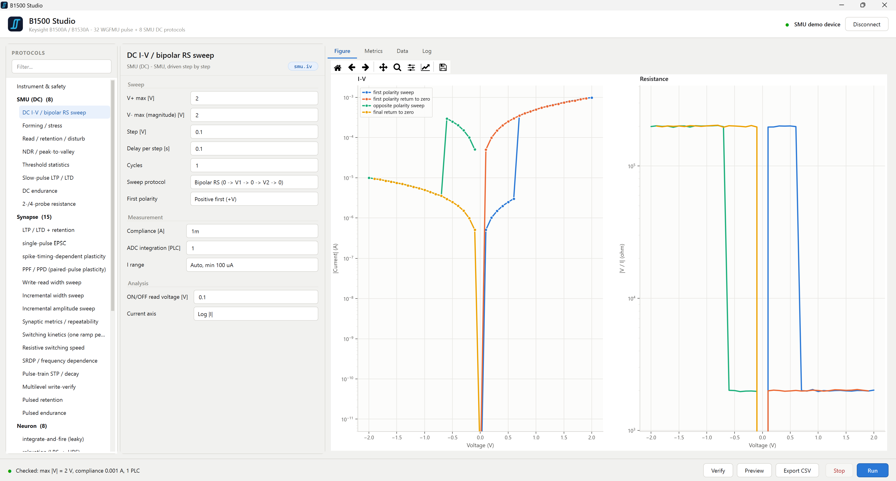

# b1500a-gui-python

Python package for the **Keysight B1500A Semiconductor Device Analyzer** over **GPIB**, covering the DC, capacitance and fast-pulse measurements used to characterize memristive, ferroelectric and other neuromorphic devices (synaptic plasticity, neuron-like spiking, forming, retention, polarization switching). GUI, command line and importable library, from one catalogue of protocols.

        


<p align="center"><em>SMU DC page - a bipolar resistive-switching loop measured
on the built-in simulator. Each limb of the sweep is drawn as its own curve;
the ON/OFF ratio is read off the finished loop.</em></p>

> A native Qt/C++ application with the same 42 protocols lives at
> [b1500-gui-cpp](https://github.com/akashnith/b1500-gui-cpp) - one executable,
> nothing to install at run time. This package is a translation of that core,
> and cross-checking the two found real bugs in both.

---

## Instrument

| | |
|---|---|
| **Model** | Keysight (formerly Agilent) B1500A Semiconductor Device Analyzer |
| **Type** | Modular, all-in-one parameter analyzer: IV, CV, pulse / dynamic IV |
| **Architecture** | Mainframe with up to 10 plug-in module slots; installed modules set the limits |
| **Current / voltage range** | 0.1 fA to 1 A, 0.5 µV to 200 V |
| **Capacitance** | Multi-frequency AC capacitance, 1 kHz to 5 MHz; quasi-static CV |
| **Measurement modes** | Spot, sweep, sampling, pulsed, transient, arbitrary waveform |
| **Modules driven here** | **SMU** (DC and staircase), **MFCMU** B1520A (capacitance), **WGFMU** B1530A (waveform generator / fast measurement unit) |
| **Software** | Embedded EasyEXPERT group+ (15-inch touchscreen, Windows) |
| **Remote control** | GPIB / VISA through PyVISA, FLEX command set; WGFMU via the Keysight B1530A instrument library (`wgfmu.dll`) |

**Links**
- Product page: <https://www.keysight.com/us/en/product/B1500A/semiconductor-device-analyzer.html>
- User's Guide, Programming Guide, B1530A WGFMU documentation, drivers and EasyEXPERT downloads: from the product page above, under *Resources / Software*.

---

## Features

- GPIB connection through PyVISA (NI-VISA or Keysight IO Libraries Suite); `*IDN?`, `UNT?` module detection and slot-to-channel mapping
- WGFMU waveform generation and execution through the B1530A library on the 10 ns ALWG grid, run in a **child process** so a VISA hang is reported instead of freezing the window
- **42 measurement protocols**, grouped by the device they measure:

| family | count | measurements |
|---|---|---|
| **SMU** (DC) | 8 | staircase I-V with independent bipolar limbs, forming / stress, read-retention-disturb, NDR and peak-to-valley, threshold statistics, slow-pulse LTP/LTD, DC endurance, 2-/4-probe resistance |
| **Synapse** | 15 | LTP/LTD trains, EPSC, PPF/PPD, STDP, width and amplitude sweeps, repeatability, switching kinetics, SRDP, STP, multilevel write-verify, retention, endurance |
| **Neuron** | 8 | integrate-and-fire, relaxation, stochastic firing, refractory periods, f-I curves, leaky integration, pulsed I-V, relaxation oscillator |
| **Ferroelectric** | 9 | PUND, P-V hysteresis, two-frequency leakage separation, antiferroelectric double loops, AFE-PUND, FTJ electroresistance, switching speed, wake-up and fatigue, accumulative switching |
| **MFCMU** | 2 | C-V butterfly with memory window, and a Rayleigh sweep of the AC level fitting `eps_r(E0) = eps_init + alpha*E0` |

- **Asymmetric sweeps.** The two limbs of a bipolar I-V are independent magnitudes - a device can SET at +2 V and RESET at -4 V - and each limb is sized from the **step**, not from a point count, so both keep the same resolution
- **Limits are checked before anything is sent.** A waveform that would exceed the ceiling is refused, not clipped: a clipped waveform is a different measurement that looks like the one you asked for. The SMU and the WGFMU get separate ceilings, because DC forming needs volts and a device that should never see them from a pulse generator should not have to
- **Compliance hits are counted, not hidden** - a clipped point is not a measurement, and anything averaged across one is wrong
- SI-aware parameter entry: type `100u`, `1m`, `2.5n` into any compliance, width or timing field
- **Every finished run is saved automatically** to its own folder - the data, the figure, and a manifest recording the protocol, parameters, wiring and metrics that produced them
- Importable as a library: every protocol is a plain object with `fields()`, `run()` and `draw()`, so a measurement is a dozen lines in a script or a notebook
- **Demo mode** exercises every protocol with no instrument attached - the simulator is a device model, not a stub
- Safe-state handling: channels driven to zero and released on error, stop, or exit

---

## Requirements

**To run against the simulator - any platform**

- Python 3.10+
- `numpy` and `matplotlib`, installed automatically
- `PySide6` for the GUI; the CLI and the library need neither it nor VISA

Nothing vendor-specific. This is the configuration the CI runs on Linux, Windows and macOS.

**To drive real hardware**

- `pyvisa`, plus **NI-VISA** or **Keysight IO Libraries Suite**
- **GPIB interface** (NI GPIB-USB-HS or equivalent) and a cable to the B1500A
- Keysight **B1530A WGFMU instrument library** (`wgfmu.dll`, Windows x64) for the pulse protocols

The SMU and MFCMU protocols need only PyVISA; the WGFMU ones need the DLL.

---

## Install

```bash
git clone https://github.com/akashnith/b1500a-gui-python.git
cd b1500a-gui-python

pip install -e ".[all]"       # GUI + VISA + tests
python -m pytest              # 577 tests, no instrument needed
```

| extra | pulls in | for |
|---|---|---|
| *(none)* | numpy, matplotlib | the library and the CLI, against the simulator |
| `[gui]` | PySide6 | the graphical interface |
| `[smu]` | pyvisa | real SMU and MFCMU hardware |
| `[dev]` | pytest | the test suite |
| `[all]` | all of the above | everything |

---

## Quick start

### Graphical interface

```bash
python -m b1500_studio gui
```

1. Protocols are grouped in the navigator by the device they measure - **SMU (DC)**, **Synapse**, **Neuron**, **Ferroelectric**. Pick one.
2. **Verify** checks the waveform against the limits without touching the instrument. **Preview** draws the bias that would be applied.
3. **Run** executes it, plots it, and fills the *Metrics* and *Data* tabs.
4. Demo mode is on by default, so steps 1-3 work with nothing connected. Untick it on the *Instrument* page, set the channels, and press **Connect** for real hardware.

### Command line

Everything the GUI runs is reachable from the shell, running the same code:

```bash
python -m b1500_studio list                  # the pulse protocols
python -m b1500_studio smu list              # the DC protocols
python -m b1500_studio smu list iv           # one protocol's fields and defaults

python -m b1500_studio smu protocol iv \
    --set sweep_v_pos_v=1.2 \
    --set sweep_v_neg_v=1.5 \
    --set sweep_step_v=0.02 \
    --common-ch 2 --out results --png

python -m b1500_studio run synapse --demo --out results --png
python -m b1500_studio cmu cv --vmax 3
python -m b1500_studio check                 # diagnose a connection failure
```

A misspelled field name is refused rather than ignored: a run that quietly used the default, and was read as though it used your value, is worse than one that does not start.

### As a library

`examples/thonny_quickstart.py` is a complete measurement in one file - open it in Thonny, IDLE or any editor and run it. In outline:

```python
from b1500_studio.core.fields import params_from_fields
from b1500_studio.instruments.demo import DemoSmu
from b1500_studio.protocols import SmuSettings, get_smu_protocol

protocol = get_smu_protocol("iv")
params = params_from_fields(protocol.fields(), {"sweep_v_pos_v": "1.5"})
setup = SmuSettings(force_ch=1, common_ch=2, vmax=3.0)

ok, message = protocol.verify(params, setup)    # no instrument is touched
smu = DemoSmu()                                  # or Smu("GPIB0::16::INSTR")
smu.open()
runs = protocol.run(smu, params, setup)
```

---

## Where the data goes

Every finished run is written to its own folder under one parent - set it on the *Instrument* page, or with `B1500_STUDIO_DATA`:

```
~/B1500-Studio-Data/2026-11-21/143052_smu.iv/
    data.csv          the points, with the metrics in the header
    figure.png        the figure at print resolution
    manifest.json     protocol, parameters, wiring, metrics, notes
```

The manifest is the part that matters six months later. A CSV of currents with no record of the compliance, the step size or the channel it came from is a column of numbers, not a measurement.

The **on-screen figure leaves the summary panel out** - those numbers are in the *Metrics* tab beside it. The **saved figure keeps it**, because a file travels on its own.

---

## Project layout

```
b1500a-gui-python/
├── pyproject.toml
├── b1500_studio/
│   ├── core/                   # plan, fields, driver, runner, verification
│   │                           #   plotting, storage, ferro  (no instrument code)
│   ├── instruments/            # smu, cmu, wgfmu_dll, session, diagnostics, demo
│   ├── experiments/            # 32 WGFMU pulse protocols
│   ├── protocols/              # 8 SMU DC protocols + the staircase
│   ├── gui/                    # PySide6 application
│   ├── resources/              # application icon
│   └── cli.py
├── tests/                      # 577 tests, no hardware required
├── examples/                   # a runnable measurement script
├── scripts/                    # .bat and .sh launchers
├── docs/                       # screenshot, simulator findings
└── .github/workflows/ci.yml    # 3 platforms x Python 3.10 / 3.12
```

Only `instruments/` opens a session, and even there VISA and the DLL are imported on first use. Everything else is importable and testable on a machine with neither - which is why the whole catalogue is exercised before it is pointed at a device.

---

## Documentation

| | |
|---|---|
| [docs/simulator-findings.md](docs/simulator-findings.md) | the bugs the simulator caught before a device did, and what each would have cost |
| [examples/thonny_quickstart.py](examples/thonny_quickstart.py) | a complete measurement as a script, with the common failures annotated |
| [scripts/README.md](scripts/README.md) | the double-click launchers |

---

## Safety

Verify sample voltage limits and compliance before running. The limits in this software are **a check on what the program is asked to send** - they are not a safety interlock, and they cannot protect a device, an instrument or a person from a wiring mistake.

A return path that is not actually connected reads as a very good insulator rather than as an error. Set the compliance for the device, not for the measurement you hope to get, confirm the bias in the preview, and use the stop control if the response looks wrong.

---

## Roadmap

- [ ] SPGU protocol coverage (pulse widths between the SMU and WGFMU ranges)
- [ ] Batch protocol sequencing across devices
- [ ] SMU and MFCMU protocols as GUI pages alongside the pulse ones
- [ ] Reset-before-read in accumulative polarization switching - a PUND read is destructive, so the present implementation measures the first point and then a flat line

---

## License

MIT. See `LICENSE`.

No Keysight source code, header, library or manual content is redistributed here; driving a B1530A requires Keysight's own `wgfmu.dll`, installed with their software.

*Keysight, Agilent, B1500A, EasyEXPERT, B1520A and B1530A are trademarks of Keysight Technologies. This project is independent and not affiliated with or endorsed by Keysight.*
